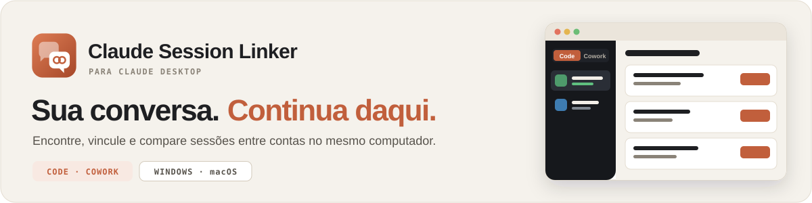
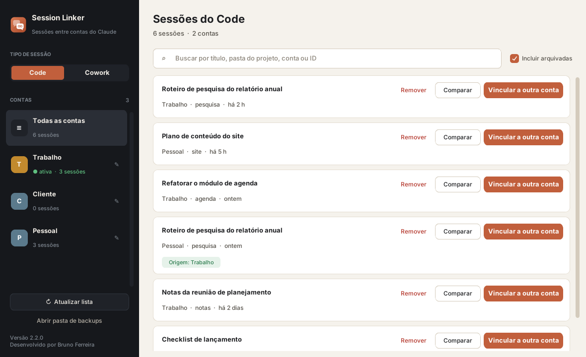

<p align="center">
  <a href="https://github.com/brunoflma/claude-session-linker/releases/latest"></a>
  
  
</p>

<p align="center">
  <a href="https://brunoflma.github.io/claude-session-linker/"><b>Página do projeto</b></a> ·
  <a href="https://github.com/brunoflma/claude-session-linker/releases/latest">Baixar</a> ·
  <a href="https://brunoflma.github.io/claude-session-linker/install-windows.html">Guia Windows</a> ·
  <a href="https://brunoflma.github.io/claude-session-linker/install-macos.html">Guia macOS</a> ·
  <a href="https://brunoflma.github.io/claude-session-linker/#instalar">Instalar com ajuda de IA</a>
</p>

# Claude Session Linker

**Encontre, vincule e compare sessões do Claude Desktop entre as contas que você usa no mesmo computador.**

Uma conversa iniciada em uma conta não aparece na barra lateral das outras. O Linker lê os dados locais das abas **Code** e **Cowork**, mostra todas as sessões de todas as contas em um só lugar e copia a sessão escolhida para a conta de destino, sempre com backup antes.



<sub>Captura com dados fictícios.</sub>

## Quando ele ajuda

| Situação | O que fazer no Linker |
| :--- | :--- |
| A conversa ficou em outra conta deste computador | **Vincular a outra conta** copia a sessão para a conta de destino. |
| Existem cópias da mesma conversa | **Comparar** mostra mensagens e atividade mais recente de cada cópia. |
| Quer continuar uma sessão Code de forma independente | O vínculo cria uma cópia própria do transcript. |
| Uma sessão precisa sair de uma conta | **Remover** apaga só daquela conta, com backup prévio. |

## Instalação

| Sistema | Setup (dentro do ZIP) | Passo a passo |
| :--- | :--- | :--- |
| Windows 10/11 | `00 - Setup Claude Session Linker.vbs` | [Guia para Windows](https://brunoflma.github.io/claude-session-linker/install-windows.html) |
| macOS | `00 - Setup Claude Session Linker.command` | [Guia para macOS](https://brunoflma.github.io/claude-session-linker/install-macos.html) |

1. Abra a [última release](https://github.com/brunoflma/claude-session-linker/releases/latest) e baixe o ZIP do seu sistema.
2. Extraia em uma pasta permanente, incluindo a pasta `.app`.
3. Rode o setup uma vez. Ele cria um ambiente Python isolado em `.app/venv`.
4. Abra pelo atalho `Claude Session Linker.vbs` (Windows) ou `Claude Session Linker.command` (macOS).

Prefere delegar a um agente? [Copie o prompt de instalação](https://brunoflma.github.io/claude-session-linker/#instalar). Ele separa a instalação de qualquer operação sobre conversas reais.

## O fluxo de uso

1. Use cada conta no Claude Desktop pelo menos uma vez e abra a aba Code ou Cowork em cada uma.
2. **Feche completamente o Claude Desktop** (bandeja do sistema no Windows, <kbd>Cmd</kbd>+<kbd>Q</kbd> no macOS). O Linker avisa no topo da janela se ele ainda estiver aberto.
3. No Linker, escolha **Code** ou **Cowork**, localize a sessão (a busca aceita título, pasta, conta ou ID) e use **Vincular a outra conta**.
4. Reabra o Claude Desktop na conta de destino para ver a sessão na barra lateral.

Atalhos: <kbd>Ctrl</kbd>+<kbd>F</kbd> busca, <kbd>Esc</kbd> limpa a busca, <kbd>F5</kbd> atualiza a lista. Clicar na linha de detalhes de uma sessão copia o caminho do projeto.

### Code e Cowork

- **Code:** o vínculo clona o transcript; cada conta passa a continuar a conversa de forma independente.
- **Cowork:** o vínculo copia o índice e a pasta local da conversa para o workspace de destino.
- **Comparação:** lê os arquivos de conversa locais. Não mescla conversas que divergiram.

## Requisitos

- Claude Desktop com pelo menos duas contas já usadas no computador.
- Python **3.11 a 3.15** (recomendado: a versão estável mais recente). No macOS, com `tkinter`; o setup tenta instalá-lo pelo Homebrew se faltar.
- No Windows, PowerShell (já incluso no sistema).

O setup instala versões fixadas de `customtkinter`, `darkdetect`, `pillow` e `packaging` (veja [`.app/requirements.txt`](.app/requirements.txt)). O uso normal não exige Node.js, banco de dados, servidor ou chave de API.

## Dados locais e recuperação

As operações de sessão trabalham só com arquivos locais do Claude Desktop e não enviam mensagens ou dados de contas para servidores. O setup acessa a internet apenas para instalar as dependências.

Cada vínculo ou remoção cria antes um backup ZIP em `.app/backups` (botão **Abrir pasta de backups** na janela):

- **Code:** a pasta de índices que será alterada.
- **Cowork:** o workspace que será alterado.

Arquivos e perfis que sejam links simbólicos são ignorados ou recusados. São reconhecidos a instalação oficial, perfis alternativos como `Claude-3p` e instalações Windows Store/MSIX.

## Limites importantes

O armazenamento do Claude Desktop não é uma API pública e pode mudar entre versões. O Linker não transfere sessões entre computadores nem funde conversas divergentes. O pacote macOS usa scripts locais e não é um aplicativo assinado ou notarizado.

Projeto independente, sem vínculo com a Anthropic. Mantenha os backups e confira os [guias](GUIA.md) antes de operar sobre sessões importantes.

## Estrutura do repositório

| Caminho | Conteúdo |
| :--- | :--- |
| `.app/session_linker.py` | Aplicativo (camada de dados e interface customtkinter). |
| `.app/setup_gui.py`, `.app/setup.ps1`, `.app/setup.sh` | Instalador do Windows e scripts de setup. |
| `.app/test_*.py` | Testes do aplicativo e do instalador, com perfis sintéticos. |
| `.app/_gen_icon.py` | Gera `icon.png` e `icon.ico` (todos os tamanhos). |
| `*.vbs`, `*.command` | Atalhos de setup e abertura para Windows e macOS. |
| `docs/` | Site do projeto (GitHub Pages), capa e prompt de instalação. |
| `scripts/` | Empacotamento verificável, publicação, checagens do site e da prévia social. |
| `.github/workflows/` | Validação em Windows e macOS, publicação por tag e checagem do site. |

### Desenvolvimento

Com as dependências de `.app/requirements.txt` instaladas, na raiz do repositório:

```bash
python -m unittest discover -s .app -p "test_*.py"
```

```bash
python -m unittest discover -s scripts -p "test_*.py"
```

```bash
python scripts/verify-site.py
```

Os testes usam perfis sintéticos e não acessam conversas reais. Para limitar a descoberta a uma pasta de teste, defina `CLAUDE_SESSION_LINKER_CLAUDE_DIR`. Novas versões seguem o [processo de publicação](RELEASING.md) e o [changelog](CHANGELOG.md); a branch `main` pode conter desenvolvimento ainda não publicado.

## Ajuda e contribuições

[Relatar um problema](https://github.com/brunoflma/claude-session-linker/issues) · [Contar sua experiência](https://github.com/brunoflma/claude-session-linker/issues/new?template=experiencia.yml) · [Guias](GUIA.md) · [Bruno Ferreira](https://github.com/brunoflma)

Ao abrir uma issue, informe sistema operacional, versão do Linker e tipo de sessão. Não anexe transcripts, credenciais, identificadores de contas ou arquivos de conversas. Se o projeto ajudar no seu fluxo, use **Star** para salvá-lo e apoiar.
